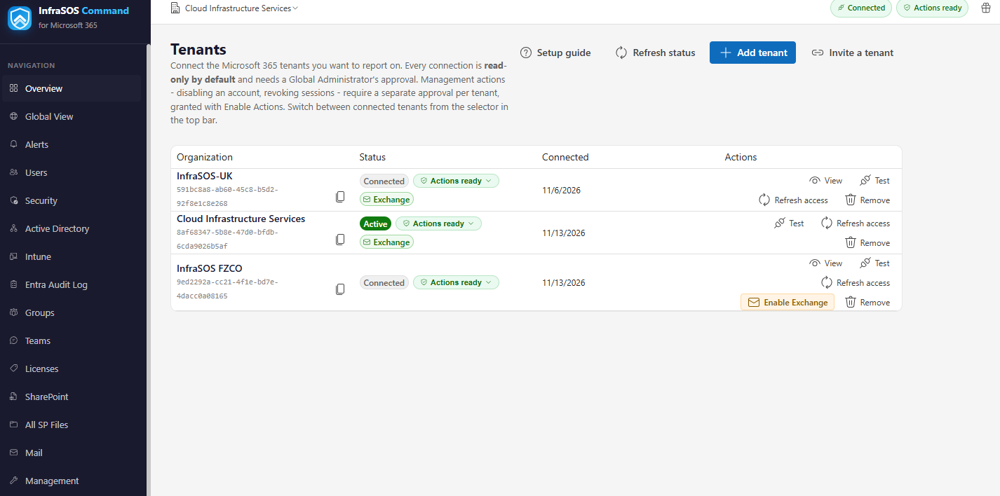

# Permissions

365 Command uses three Entra applications, and they are kept separate on purpose: signing in,
reading (reporting), and writing (management) each request only what that job needs, so no one is
ever shown more access than they are actually turning on.

The consent screen Microsoft shows you is always the authoritative list for a given tenant. This
page explains what each permission is for. For how the service is hosted and what it stores, see
[Security and data handling](security-and-data.md).

## Sign-in application

Signing in to the console uses **delegated** permissions only, and grants no access to directory
data:

| Permission | Type | For |
| --- | --- | --- |
| `openid`, `profile`, `email` | Delegated | Signing you in |
| `User.Read` | Delegated | Your own name and email, to show who is signed in |

## Reporting application (read-only)

Every report reads through the **InfraSOS Command** application using **Application** permissions
(app-only). It can read, and only read. These are granted when you connect a tenant.

**Core reporting permissions:**

| Permission | Reads |
| --- | --- |
| `User.Read.All` | Accounts, attributes, status and sign-in activity |
| `Group.Read.All` | Groups, membership and ownership |
| `Directory.Read.All` | Directory objects, roles and app consents |
| `Organization.Read.All` | Tenant and licence information |
| `Reports.Read.All` | Usage and activity reports, MFA registration |
| `AuditLog.Read.All` | Sign-in and directory audit logs |
| `Policy.Read.All` | Conditional Access policies |
| `RoleManagement.Read.Directory` | Directory role assignments (admin exposure) |
| `Sites.Read.All` | SharePoint and OneDrive sites, storage and sharing |

**Added for specific reports** (some also require an Entra ID licence on the tenant):

| Permission | Enables | Note |
| --- | --- | --- |
| `SecurityEvents.Read.All` | Microsoft Secure Score and its history | |
| `IdentityRiskyUser.Read.All` | Risky users and risk detections | Needs Entra ID **P2** |
| `UserAuthenticationMethod.Read.All` | Per-user MFA method detail | |
| `DeviceManagementManagedDevices.Read.All` | Intune managed devices, compliance and at-risk | Needs an Intune licence |
| `SharePointTenantSettings.Read.All` | Tenant-wide SharePoint sharing settings | |
| `ServiceHealth.Read.All` | Microsoft 365 service health incidents and advisories, and the Service Health alert profile | |

!!! note "A missing read permission never breaks the console"
    If a report needs a permission the tenant has not granted - or a licence it does not have - that
    report shows a greyed **Unavailable** panel naming what is missing, and every other report keeps
    working. Add the permission and use **Refresh permissions** on the Tenants page to pick it up.

## Management application (write)

Actions run through the separate **InfraSOS Command - Management** application, consented only when
you turn on management for a tenant. Readiness is computed **per action**: each one is offered only
when the specific permission below is present, so a tenant missing one permission keeps every other
action working.

**Baseline** - granted when you enable management:

| Permission | Actions it enables |
| --- | --- |
| `User.ReadWrite.All` | Disable / enable / update users, require password change, onboard a user |
| `User.RevokeSessions.All` | Revoke sign-in sessions |
| `Group.ReadWrite.All` | Add / remove group members, create and delete groups |
| `DelegatedPermissionGrant.ReadWrite.All` | Revoke OAuth application consents |

**Optional** - add each on the management app registration when you want the actions it unlocks:

| Permission | Actions it enables |
| --- | --- |
| `Device.ReadWrite.All` | Disable or delete devices |
| `Application.ReadWrite.All` | Remove application secrets and certificates |
| `Policy.ReadWrite.ConditionalAccess` | Enable, disable or set a Conditional Access policy to report-only |
| `RoleManagement.ReadWrite.Directory` | Assign or remove directory role assignments |
| `UserAuthenticationMethod.ReadWrite.All` | Reset a user's MFA methods |
| `TeamSettings.ReadWrite.All` | Archive or unarchive teams |
| `TeamMember.ReadWrite.All` | Add members to teams |
| `MailboxSettings.ReadWrite` | Set mailbox auto-replies (out-of-office) |
| `Mail.ReadWrite` | Remove mailbox forwarding inbox rules |
| `Sites.ReadWrite.All` | Remove SharePoint / OneDrive sharing |

Until an optional permission is granted and re-consented, its actions appear disabled with the
reason; nothing else is affected.

## Directory roles

A Graph **permission** lets the management application call an API. For account and role changes,
Entra **also** requires the application's service principal to hold a **directory role** in the
customer tenant - the permission alone returns `403` without it.

| Role | Needed for | Beyond |
| --- | --- | --- |
| **User Administrator** | All baseline user actions (disable, enable, reset password, onboard, offboard) | The baseline. Assign it when you enable management. |
| **Authentication Administrator** | Reset MFA | Use **Privileged** Authentication Administrator if the target account is itself an administrator |
| **Privileged Role Administrator** | Assign or remove a directory role | You can only manage roles at or below your own privilege |

Assign a role in the customer tenant: **Entra admin center → Roles and administrators →** the role
**→ Add assignments →** search for the **InfraSOS Command - Management** application. Admin consent
to the app does **not** assign these roles; it is a separate, deliberate step.

!!! warning "The privileged actions are a bigger ask"
    Reset MFA, Assign role and Remove role need the roles above, which are more privileged than the
    User Administrator baseline. Treat them as advanced, opt-in actions: a customer can run every
    other management action without granting them. When one is attempted without its role, the
    failure names the exact role to assign.

## Exchange Online (Mail) runner

The **Exchange (Mail)** area is powered by a separate **InfraSOS EXO Runner** application. The core
reporting app reads Microsoft Graph, but many Exchange features (message trace, mail-flow rules,
mailbox permissions, protocol exposure, the unified audit log, retention and DLP policies) have no
Graph equivalent, so they are read through Exchange Online and the Microsoft Purview endpoints using
**application (app-only) certificate** authentication. The signing certificate lives on the InfraSOS
side; you never handle a secret or certificate.

There is nothing to install by hand: enabling the runner for a tenant is a one-click step in the
portal, described next. The one extra grant that two of its tabs need follows after.

### Enable Exchange for a tenant

On the **Tenants** page, find the tenant and select **Enable Exchange** in its row:



You are taken to Microsoft's consent screen to approve the **InfraSOS EXO Runner** application for that
tenant — a Global Administrator approves it, exactly as when connecting the tenant. Select **Accept**.
Back on the Tenants page the tenant shows a green **Exchange** badge (as above) and the Exchange (Mail)
tabs begin returning live data. This grants the runner's Exchange access only; the two Purview tabs
below need one extra role.

### Granting the Security and Compliance role

!!! info "Enable Exchange first"
    These two tabs light up only once the tenant has **[Enable Exchange](#enable-exchange-for-a-tenant)**
    completed **and** the role below assigned. If you have not enabled Exchange for the tenant yet, do
    that first — until then every Exchange tab, these two included, stays on sample data.

Two tabs, **Audit Log** and **Compliance Policies**, read through the Microsoft 365 **Security &
Compliance (Purview)** endpoint rather than Exchange Online, and that endpoint requires a **directory
role** that app consent cannot grant on its own. Until it is assigned, those two tabs show a
"permission required" notice instead of data; every other Exchange tab is unaffected.

Assign the **InfraSOS EXO Runner** application the **Compliance Administrator** role (it includes the
*View-Only Audit Logs* permission the unified audit log search requires):

**Entra admin center → Roles and administrators → Compliance Administrator → Add assignments →**
search for **InfraSOS EXO Runner → Add.**

!!! note "After granting the role"
    Role changes can take a few minutes to take effect; reopen the tab after a short wait. The
    **unified audit log** also has ingestion latency, so recent actions can take 30 minutes or more to
    appear, and **Compliance Policies** is empty until your tenant actually has retention, DLP or
    eDiscovery policies configured.

### Quarantine is read-only; remediate in Microsoft Defender

!!! info "Enable Exchange first"
    The **Quarantine** tab appears once the tenant has **[Enable Exchange](#enable-exchange-for-a-tenant)**
    completed. It reads through the runner's default **Global Reader** role — no extra role is needed.

The **Quarantine** tab shows quarantined messages, why they were held, their status (**Pending Review**,
**Released** or **Denied**), and lets you **download** the raw message (`.eml`) for inspection. These are
all read operations and work out of the box.

**Releasing or denying (deleting) a quarantined message is done in Microsoft Defender, not in InfraSOS.**
Microsoft authorises those actions against the **signed-in user's** quarantine permissions, and InfraSOS
connects to Exchange Online with an **application identity** (app-only certificate) that has no user
context — so release and deny cannot be performed from InfraSOS regardless of the directory roles the
runner holds. The message drawer links straight to **Manage in Microsoft Defender**
([security.microsoft.com/quarantine](https://security.microsoft.com/quarantine)), where you release, deny,
preview and allow senders with your own admin permissions.

!!! note "No Security Administrator role is needed"
    Quarantine actions aren't performed from InfraSOS, so the runner needs no **Security Administrator**
    (or other quarantine) role — **Global Reader** already covers everything the Quarantine tab reads.
    App-only quarantine writes aren't supported by Microsoft
    ([reference](https://learn.microsoft.com/en-us/defender-office-365/quarantine-admin-manage-messages-files)),
    which is why remediation happens in Microsoft Defender.

### Mailbox delegation (Full Access / Send As)

!!! info "Enable Exchange first"
    The **Permissions** tab appears once the tenant has **[Enable Exchange](#enable-exchange-for-a-tenant)**
    completed. **Viewing** delegation (who has Full Access, Send As and Send on Behalf on each mailbox) and
    the governance columns (hidden-from-GAL, litigation hold, archive, retention) work out of the box under
    the runner's default **Global Reader** role — no extra role is needed.

**Granting or removing** a delegate is a write, and Exchange requires the runner to hold the **Mail
Recipients** management role on the tenant. This is an *Exchange management role*, not an Entra directory
role, so it is assigned in **Exchange Online PowerShell** (the Entra portal and app consent cannot grant
it). Until it is assigned, the Grant / Remove controls show a setup notice instead of running.

Sign in to Exchange Online as an **Exchange Administrator** (or Global Administrator) and run:

```powershell
Connect-ExchangeOnline

# InfraSOS EXO Runner application id (the same for every tenant):
$appId = "750709b4-79b6-478d-a6dc-787e5aa8a89b"

# Find the runner's Exchange service principal (created when you enabled Exchange):
$sp = Get-ServicePrincipal | Where-Object { $_.AppId -eq $appId }

# Assign the Mail Recipients role to it:
New-ManagementRoleAssignment -Role "Mail Recipients" -App $sp.ObjectId
```

Confirm it covers the delegation cmdlets:

```powershell
Get-ManagementRole -Cmdlet Add-MailboxPermission      # should list "Mail Recipients"
Get-ManagementRoleAssignment -RoleAssignee "InfraSOS EXO Runner"
```

!!! note "After granting the role"
    Exchange builds the application's available-cmdlet set from its roles **at connection time**, and the
    role assignment can take **up to an hour** to propagate. After granting it, click **Refresh Exchange**
    on the **Tenants** page (this reconnects the runner so it picks up the new role), then reload the
    **Permissions** tab. If the Grant / Remove controls are still greyed out, the change is still
    propagating — wait a little longer and reload again. Calendar and folder delegation remain view-only
    for now.

### Email security, mail flow and tenant allow/block writes

Managing **email security policies**, the **tenant allow/block list** and **mail-flow (transport)
rules** needs the runner's **Transport Hygiene** Exchange management role, assigned in Exchange Online
PowerShell the same way as the **Mail Recipients** role above. Viewing these works under the runner's
default Global Reader; only the writes need the role. The full role-to-action map is in
[Exchange (Mail) → What the runner needs](exchange.md#what-the-runner-needs).

## Keeping permissions current

When 365 Command adds a capability that needs a new permission, connected tenants are flagged with
an **update available** note. **Refresh permissions** (reporting) or **Refresh access** (management)
re-runs consent and picks up the new scopes, without disturbing what already works.
