<!-- Restored from the archived HelpScout knowledge base (support.infrasos.com/article/14-infrasos-self-service-password-reset) via the Wayback Machine, 2026-10-15. Images self-hosted under assets/screenshots/sspr/. -->

# Self-Service Password Reset — setup guide
Getting start with our [Active Directory self service portal](https://infrasos.com/active-directory-password-reset-tool-self-service-portal/).

<iframe src="https://www.youtube.com/embed/YNfj6GMOkmA" title="InfraSOS Self-Service Password Reset setup" style="position:absolute;inset:0;width:100%;height:100%;border:0;border-radius:8px" allow="accelerometer; autoplay; clipboard-write; encrypted-media; gyroscope; picture-in-picture" allowfullscreen></iframe>

## Download Links

-   Deploy on [Azure](https://azuremarketplace.microsoft.com/en-us/marketplace/apps/cloud-infrastructure-services.active-directory-password-reset-tool)
-   Deploy on [GCP](https://console.cloud.google.com/marketplace/product/cloud-infrastructure-services/active-directory-self-service-password-reset)
-   Deploy on [AWS](https://aws.amazon.com/marketplace/pp/prodview-4miludv44yxgw)

## Step 1 - Join VM to your Active Directory Domain

  

Before you can use or login to the portal you will need to join the VM to your domain.

1.  On the Desktop, click the **Start** button, type **Control Panel**, and then press **ENTER**.
2.  Navigate to **System and Security**, and then click **System**.
3.  Under **Related settings**, click **Rename this PC (advanced)**.
4.  Under the **Computer Name tab**, click **Change**.
5.  Under **Member of**, click **Domain**, type the **name of the domain** that you wish this server to join, and then **click OK**.
6.  Click **OK** in the Computer Name/Domain Changes dialog box, and then **restart the server**.

## Step 2 - Create AD Security Groups (Control User Permissions)

InfraSOS Self Service Portal requires the following Active Directory security groups setup in order for the portal to work correctly, otherwise you will get errors loading pages:

**Note:** The group name must be named exactly as per the group name in the table.

| Group Name | Description |
|---|---|
| **InfraSOS-Admins** | Gives admins full access to all portal admin settings, such as configuration, running reports, viewing the dashboard and complete setup settings. |
| **InfraSOS-Self-Update** | Allows users to update their Active Directory profile under **Update Profile** within the portal. Users not in this group will only have read-only access to their profile. |

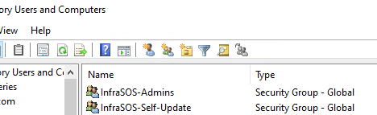

InfraSOS Required AD Groups

All domain users will have access to login and reset their password, use employee search and view their profile attributes.

## Step 3 - Active Directory Delegation Control For InfraSOS Server

  

In order for the local service account (**InfraSOS AD Self-Service**) on the InfraSOS server to manage password resets or report actions and updates, the server requires deletion control permissions with your Active Directory domain.

Open your **Active Directory Users and Computers** console

**Right click on your domain** and select **Delegation Control**

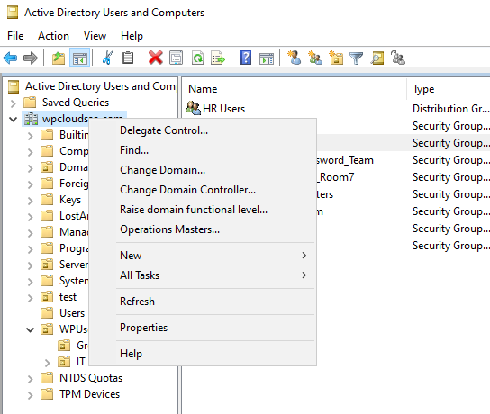

Select **Next**

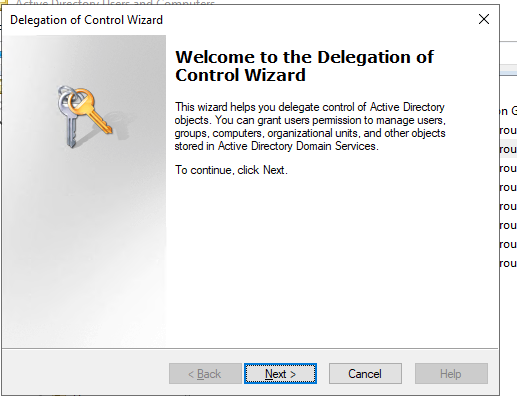

Press **Add**

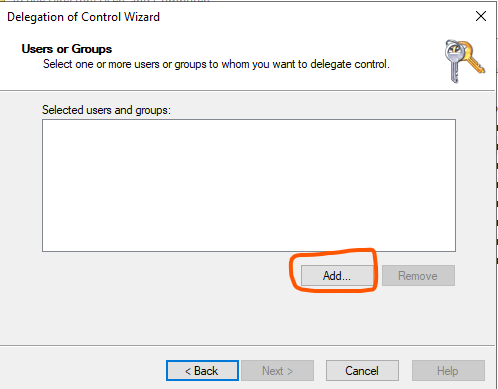

Click on **Object Types**

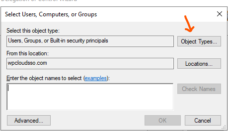

**Select Computers** and **deselect everything else** and **press OK**

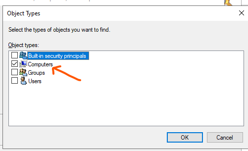

Next is to **search for the InfraSOS server** in your domain. The name will depend on what you've called the host name in your AD . Once you've found it, press next

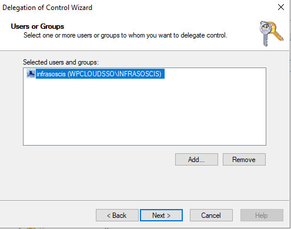

On the next screen are the permissions we're going to give this host. **Select the following**

1.  Create, delete and manager user accounts
2.  Reset user passwords and force password change at next logon
3.  Read all user information

Then press next

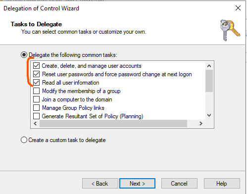

Wait for it to process and you will receive the following summary page and **press Finish**

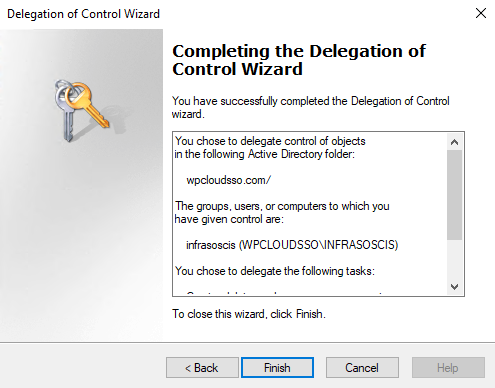

Log back into your InfraSOS server and restart the service via the desktop shortcuts

1.  Stop InfraSOS Service
2.  Start InfraSOS Service

Or manually restart the service within Windows Services:

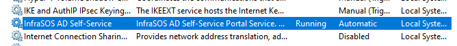

## Step 4 - Create Certificate for https (optional)

  

If you would like to enable https for your portal access simply use a certificate if you're using an internal PKI or you can also create a [self signed certificate.](https://learn.microsoft.com/en-us/powershell/module/pki/new-selfsignedcertificate?view=windowsserver2022-ps)

Login to the portal as an admin (Admins are users in the **InfraSOS-Admins** Active Directory group you created in step 2).

The login URL is:

http://localhost

Browse to **Admin Settings / Portal Certificate**

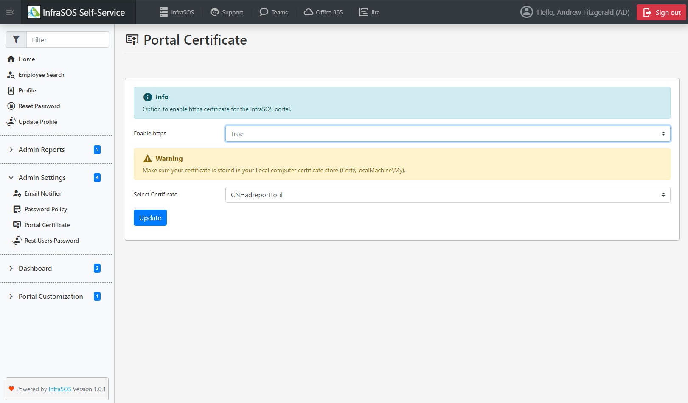

Select '**True**' on **Enable https**

Select your certificate you've created in the drop down menu.

If you don't see your certificate, make sure you've added it to the local computer certificate store:

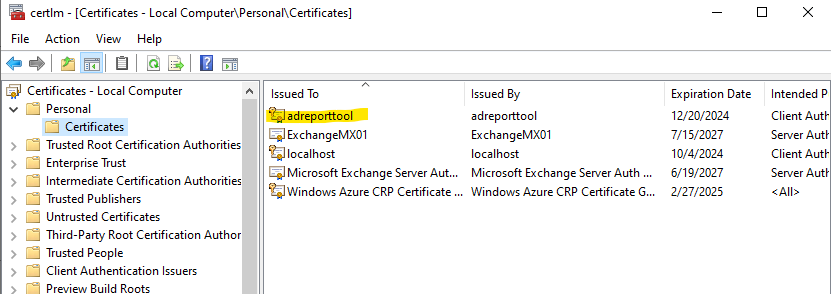

Once you've pressed update to apply the certificate configuration, close down the browser and restart the InfraSOS service via the desktop shortcuts:

1.  Stop InfraSOS Service
2.  Start InfraSOS Service

Or you can manually restart the Windows service - **InfraSOS AD Self-Service**

Now you can login using the portal using https using the DNS name you specified in your certificate. For example my certificate DNS name is **ADReportTool**, so my new login is:

**https://adreporttool**

**Note:** If you're are using a self signed certificate, remember to deploy this certificate to all your users computers [via GPO](https://learn.microsoft.com/en-us/windows-server/identity/ad-fs/deployment/distribute-certificates-to-client-computers-by-using-group-policy).

## Step 5 - Setup AD Password Expiry Email Reminders

### 1) SMTP Configuration

To setup Active Directory password expiration notification emails go to **Admin Settings / Email Notifier**

Under **SMTP Configuration** add in your SMTP server settings with the mail box that will send the password reminder emails (**Note**: make sure your SMTP server is accessible to the InfraSOS server):

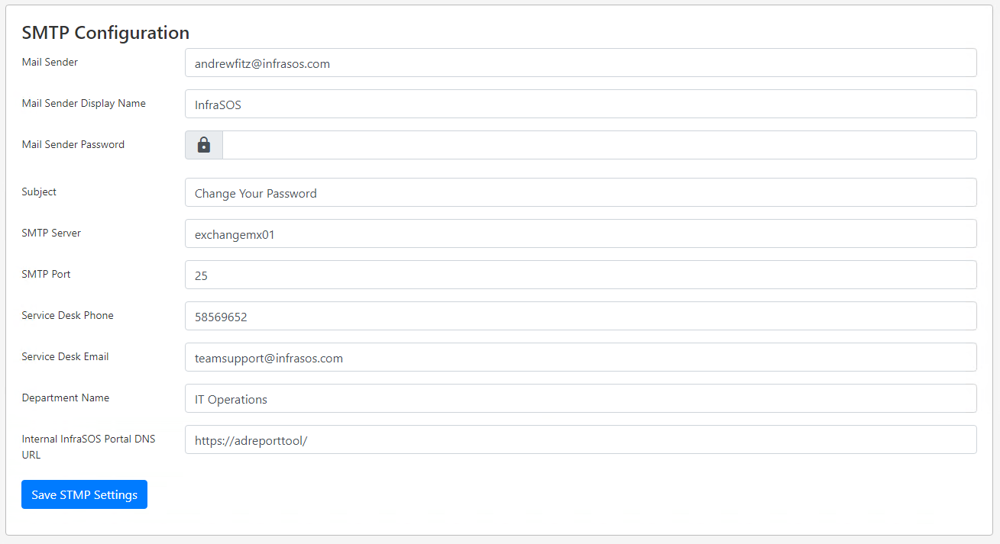

Once you've saved your SMTP settings, you can now test your configuration to make sure it works and your SMTP server connectivity from the InfraSOS server works:

### 2) Test SMTP Connectivity

Further down under **Test SMTP Settings** simply press the green **Test SMTP Connection** button

  

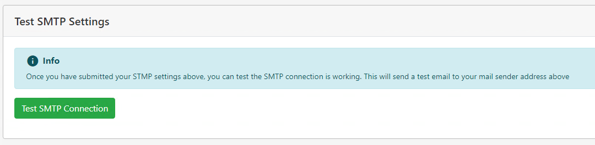

Log into your mail sender mail box to confirm you've received a test email

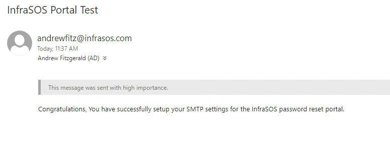

### 3) Enable / Disable Password Notification Service

Once you've confirmed your SMTP is working, you can now enable password reminder emails to start sending based on users whose password expires 14, 7 & 3 days. Once you **select Enable** this creates a **Windows Task schedule** called **InfraSOS** and runs everyday at 10 am based on the timezone your server is configured for. If you would like to disable this, simply select **Disable** option and this automatically disables the Windows task schedule and all email reminder emails.

  

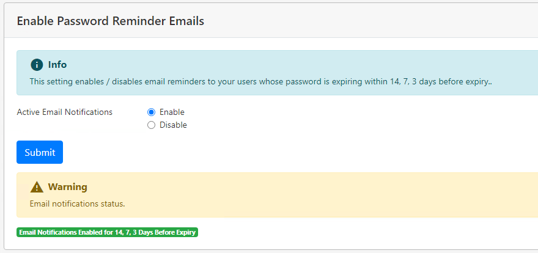

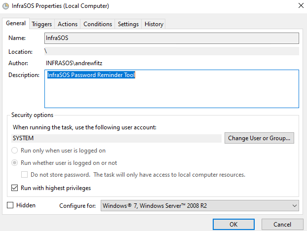

### 4) Edit Password Reminder Email Template

To view the current email template, press the yellow button **View Email Template** and this is the email that is sent to users. If you would like to make edits to this email, open the following PowerShell module file in Powershell ISE or Notepad "**C:\\InfraSOS\\Email\\Get-Emailbody.psm1**". Once you've edited and saved this Powershell module file, you can reload this page to view the updated email template.

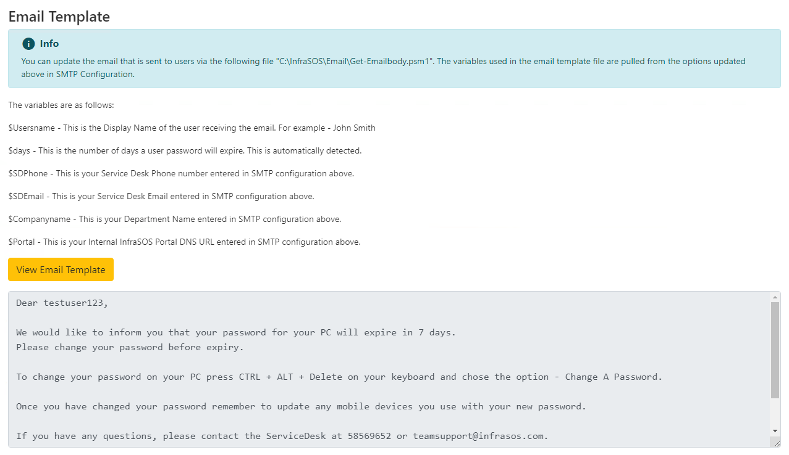

## Step 6 - Password Policy

If users reset their password within the portal, it automatically generates a completely randomized secure password that meets all modern security standards and requirements (a combination of upper, and lower case alphabets, numbers, and special characters) with a minimum password length of 8 characters.

Users passwords are set to change at next login after they self serve reset their password. If you need to change the minimum password reset length simply update using the form in **Admin Settings / Password Policy**

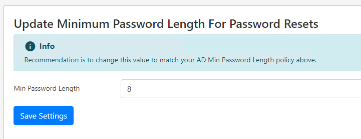

## Step 7 - Portal Header Customization

Admins can customize the header buttons within the portal to link to any website or internal web applications, making it easy for users to navigate to your company applications:

Navigate to **Portal Customization / Customize Header Icons**

The portal currently supports 5 header buttons. Simply replace all the fields with whichever icon, link, name you would like. Icons can be found on [https://pictogrammers.com/library/mdi/](https://pictogrammers.com/library/mdi/). Icon name goes into the **Icon x logo** field

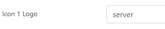

## Step 8 - Active Directory Reporting & Management

### 1) Active Directory User Reports

Within the portal, Admins can run 5 built-in reports under **Admin Reports**:

1.  Disabled Users
2.  Password Expired Users
3.  Risky Users - Password Set to Never Expire
4.  Users Never Logged On
5.  Users Not Logged in Past 60 Days

There is also a **Dashboard view**, that gives an overview of your user metrics such as:

1.  Total Disabled Users
2.  Total Number of users Not Logged in past 60 Days
3.  Total Password Resets in 7 Days
4.  Total Number of Users with Password Expired
5.  Total Number of Users set to Never Expire
6.  Total Number of Users Never Logged In
7.  Total Number of Domain Admins
8.  Total Number of Recently Modified Users in Last 7 Days

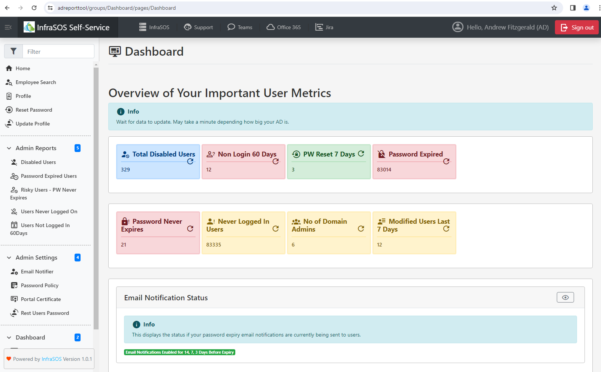

### 2) Report Actions

Within some of these reports you can **perform actions** such as **Disable, Enable** & **remove password never expire setting.**

**Note**: Users in the default Users container can't have actions applied to them only users in OUs. This is due to AD security controls on containers.

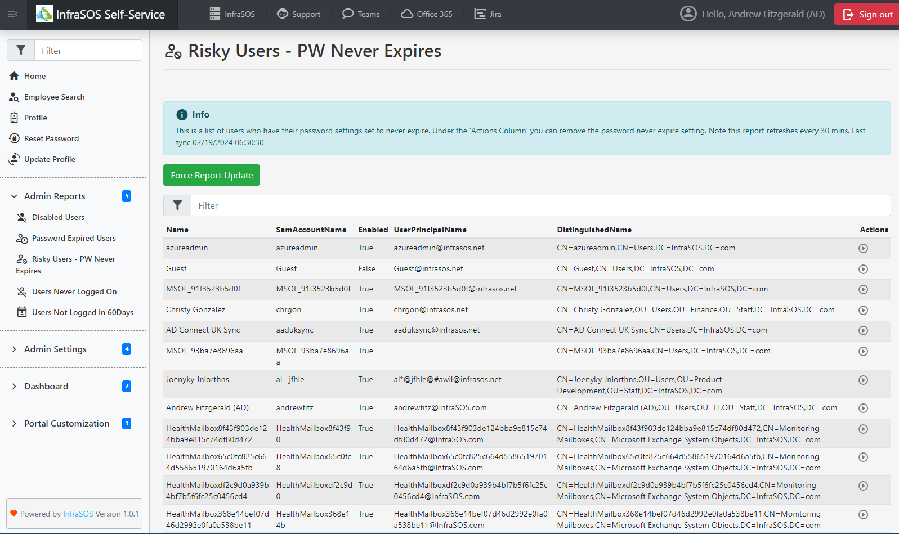

### 3) Reset a Users Password

Admins can reset any users password via **Admin Settings / Reset Users Password**

Simply search for a user by their First / Last name. Then **click on the user** and once you've clicked on a selected user it automatically resets their password. **The new password** will be **displayed in the box** labeled **New Password**:

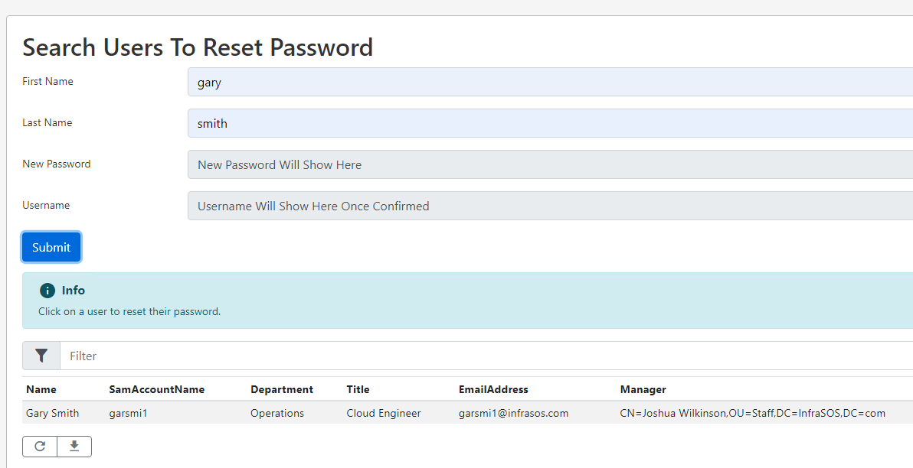

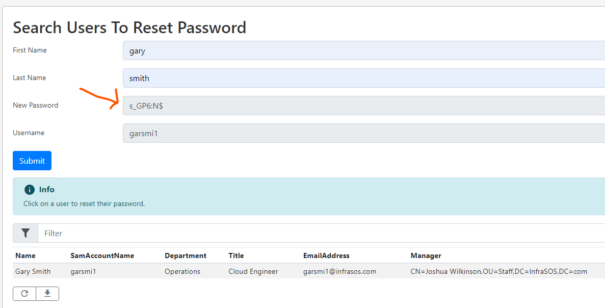

### 4) Email Logs

You can view recent emails that have been sent to users, to confirm that emails are being sent out to users whose password is expiring. Under **Dashboard / Todays Email Log** press the blue **Open button** will show the latest log from today showing if emails have been sent out today. To view all previous days emails that have been sent, go to the following folder on the InfraSOS server C:\\InfraSOS\\Log:

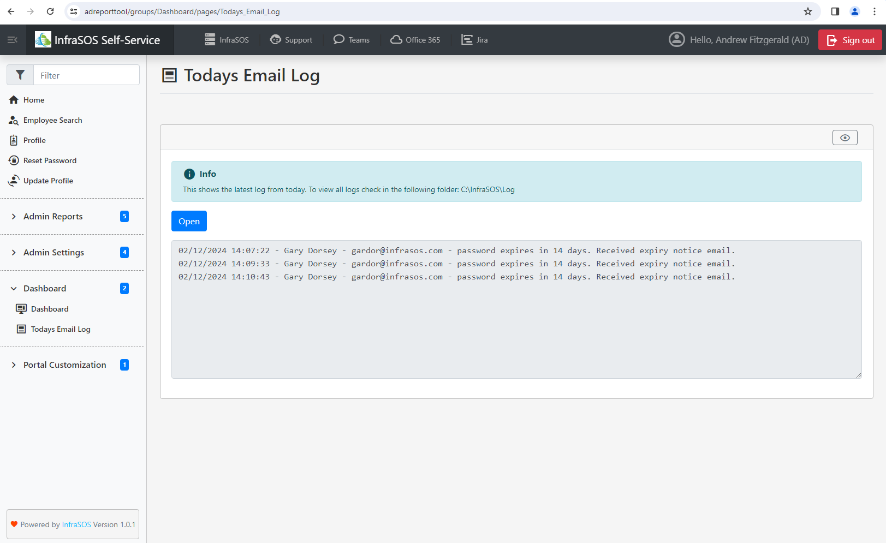

### 5) InfraSOS Server Error Logs

All logs related to InfraSOS portal are on the following directory on the server:

C:\\InfraSOS\\Log\\Error