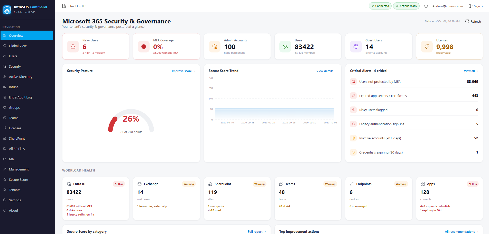

---
hide:
  - navigation
---

# InfraSOS documentation

**Monitor, audit and secure your identity infrastructure.** Documentation for the InfraSOS product
family. **365 Command** is available now; **AD Command** and **AD Command Pro** are in
development, with placeholder pages so the structure of this site stays honest about what exists.

/// caption
365 Command: Microsoft 365 and Entra ID reporting and management, at command.infrasos.com.
///

## Where do you want to start?

-   :material-shield-check:{ .lg .middle } **AD Command** &nbsp; In development

    ---

    Deployment, security assessment, health and monitoring for Active Directory, running **on a
    domain controller**. Distributed as an AWS Marketplace AMI and billed on instance usage.

    [:octicons-arrow-right-24: Read the documentation](ad-command/index.md)

-   :material-account-edit:{ .lg .middle } **AD Command Pro** &nbsp; In development

    ---

    Everything AD Command does, plus **directory management** - unlock, reset, enable and disable
    accounts, group membership and attribute edits - on a domain-joined member server.

    [:octicons-arrow-right-24: What is planned](ad-command-pro.md)

-   :material-microsoft-office:{ .lg .middle } **365 Command** &nbsp; Available

    ---

    Microsoft 365 reporting and management. A separate product rather than a module of the others,
    because it authenticates to a different directory and shares no deployment model with them.

    [:octicons-arrow-right-24: Read the documentation](365-command/index.md)

-   :material-lifebuoy:{ .lg .middle } **Support**

    ---

    What to try first, what the support bundle contains and what it deliberately does not, and how
    to reach us.

    [:octicons-arrow-right-24: Get help](support.md)

## What 365 Command does

-   :material-file-chart:{ .lg .middle } **Report on your whole Microsoft 365 estate**

    ---

    Users, guests, licences, groups, Exchange Online mailboxes, Microsoft Teams, SharePoint, OneDrive
    and Intune devices. Surface inactive accounts, unused licences and access risks, then export to
    CSV, Excel or PDF, or schedule a report by email.

-   :material-shield-check:{ .lg .middle } **See your security posture at a glance**

    ---

    Microsoft Secure Score, MFA registration and Conditional Access coverage, risky users, legacy
    authentication and privileged accounts - with the findings that need attention surfaced first.

-   :material-account-cog:{ .lg .middle } **Act without PowerShell**

    ---

    Onboard and offboard users, reset passwords and MFA, and manage licences, groups and directory
    roles - individually or in bulk - taken straight from the report, with per-action permission
    controls.

-   :material-bell-ring:{ .lg .middle } **Alerts and scheduled reports**

    ---

    Be told about new administrators, guest accounts and risky users, and watch MFA coverage, Secure
    Score and licence thresholds. Have any report delivered to your inbox on the cadence you choose.

-   :material-earth:{ .lg .middle } **Manage every tenant from one console**

    ---

    Connect multiple Microsoft 365 tenants and compare their security posture, findings and trends in
    the MSP Global View. Delegate access with administrator, operator and viewer roles.

-   :material-lock-check:{ .lg .middle } **Secure by design**

    ---

    Hosted in Microsoft Azure, read-only by default, with reporting and management permissions split
    across separate Microsoft Entra applications. Consent is granted per tenant and can be revoked at
    any time.

